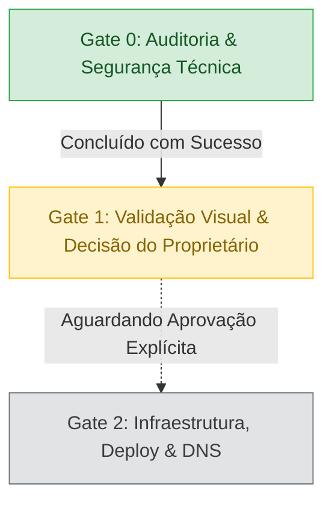

# Decisão de Prontidão (Go / No-Go) — Release Candidate #21

Data da Avaliação: 2026-10-16  
Commit Base `main`: `5f7e85c54ce6ee7caafb539415d9cbae562ad380`  
Branch Local: `audit/issue-21-production-readiness`  
Servidor de Prévia: `http://localhost:3100`  
Status Geral: **GO CONDICIONAL — Aguardando Aprovação do Proprietário (Gate 1)**

---

## 1. Veredito Executivo

O código e os ativos do projeto foram integralmente auditados, corrigidos e validados por suítes automatizadas de teste e medições reais. **Não há impeditivos técnicos que inviabilizem o lançamento.**

De acordo com as regras obrigatórias de `AGENTS.md` e o plano de lançamento, **todas as alterações permanecem exclusivamente locais**. O projeto está pronto para a sua validação visual e decisão final antes de qualquer ação externa (push, pull request, contratação de infraestrutura ou alteração de DNS).

---

## 2. Status dos Gates de Lançamento

| Gate | Descrição | Status | Evidência Principal |
|---|---|---|---|
| **Gate 0** | Auditoria técnica, segurança de APIs, privacidade e compatibilidade cross-browser. | **CONCLUÍDO (100%)** | `scripts/api-security.test.cjs` (8/8), `scripts/check-launch-http.mjs` (56/56), Lighthouse SEO/A11y/Best Practices (100). |
| **Gate 1** | Aprovação visual das adaptações locais e decisão de infraestrutura pelo proprietário. | **EM ESPERA (Ação do Usuário)** | Prévia local funcional em `http://localhost:3100`. |
| **Gate 2** | Provisionamento de host, configuração de variáveis, promoção do artefato e corte de DNS. | **BLOQUEADO** | Aguarda autorização explícita do Gate 1. |

---

## 3. Matriz de Resolução de Riscos

| Risco / Área | Nível | Decisão / Mitigação Implementada |
|---|---|---|
| **Capturas clínicas de Psicologia** | P0 | **Esclarecido pelo responsável:** todas as informações são simuladas. Conteúdo mantido sem exposição real de dados. |
| **Entrega real de e-mails** | P1 | **Validado:** domínio verificado no Resend; 2 envios reais entregues com sucesso e confirmados pelo responsável. |
| **Newsletter sem fluxo de consentimento** | P1 | **Pausada:** UI desativada com aviso transparente em PT/EN; endpoint retorna HTTP 503 `no-store` sem coletar dados. |
| **Esgotamento de memória por streaming** | P1 | **Corrigido:** `readJsonBody` limita corpo a 8 KB com cancelamento em stream e timeout de 5 s. |
| **Abuso do formulário de contato** | P1 | **Mitigado:** Honeypot ativo + teto de 3 envios/min por e-mail e 30 envios/min por instância. WAF recomendado no host. |
| **Acessibilidade e Usabilidade** | P1 | **Corrigido:** Fallback `<StaticHome>` sem JS; botão "Pular introdução"; foco confinado em modais; controle de pausa em carrosséis. |
| **SEO e Descoberta** | P1 | **Corrigido:** Sitemap XML com 10 rotas canônicas e hreflang recíproco; robots.txt; imagem social de 1200×630 px. |
| **Segurança HTTP** | P2 | **Corrigido:** Cabeçalhos `nosniff`, `DENY`, referrer rigoroso, CSP `frame-ancestors 'none'`. |
| **Higiene de Dependências** | P2 | **Corrigido:** Removidos 381 pacotes não utilizados; 0 vulnerabilidades em dependências de runtime. |

---

## 4. Decisões e Aprovações Necessárias do Proprietário (Gate 1)

Para autorizar a abertura do PR e a promoção para produção, as seguintes definições são necessárias:

1. **Aprovação Visual da Prévia Local**:
   - Navegação pela Home (`http://localhost:3100` e `/en`), verificando a intro, o botão de skip e o rodapé.
   - Verificação das páginas internas (`/trabalhos`, `/servicos`, `/por-que-side`, `/contato`).
   - Confirmação do estado pausado da Newsletter no rodapé.
   - Confirmação do aviso editorial em depoimentos e do aviso de dados no formulário de contato.

2. **Escolha do Provedor de Hospedagem (conforme [deployment-plan.md](deployment-plan.md))**:
   - **Opção Recomendada:** **Vercel Pro (US$ 20/mês)** — suporte nativo a Next.js 16 App Router, ISR, Proxy e otimização de imagens sem adaptações.
   - **Opção Alternativa:** **Render Web Service (a partir de US$ 7/mês)** — servidor Node persistente (`npm start`), exigindo gestão manual de cache e recursos.

3. **Credenciais de Produção**:
   - Criar uma chave de API **exclusiva de produção** no painel da Resend (somente permissão de envio, vinculada ao domínio `sidecode.com.br`).
   - Inserir a chave diretamente no painel seguro do provedor escolhido como `RESEND_API_KEY`.

4. **Contas Sociais (Opcional)**:
   - Se os links de Instagram e LinkedIn oficiais estiverem aprovados, preencher `NEXT_PUBLIC_SIDE_INSTAGRAM_URL` e `NEXT_PUBLIC_SIDE_LINKEDIN_URL`. Caso contrário, manter não configurados (permanecerão inertes e acessíveis).

---

## 5. Plano de Rollback Imediato

Se, após o corte de DNS ou publicação, qualquer anomalia for detectada (HTTP 5xx contínuo ou falha crítica de envio de leads):
1. **Host web**: Reverter instantaneamente o deployment no painel do provedor para a versão estável anterior.
2. **DNS / E-mail**: **Não alterar os registros MX/SPF/DKIM existentes da Zoho e do Resend**. O serviço de correio continuará operando normalmente.
3. **Contato manual**: A caixa de correio `contato@sidecode.com.br` permanece funcional e independente da hospedagem web.
